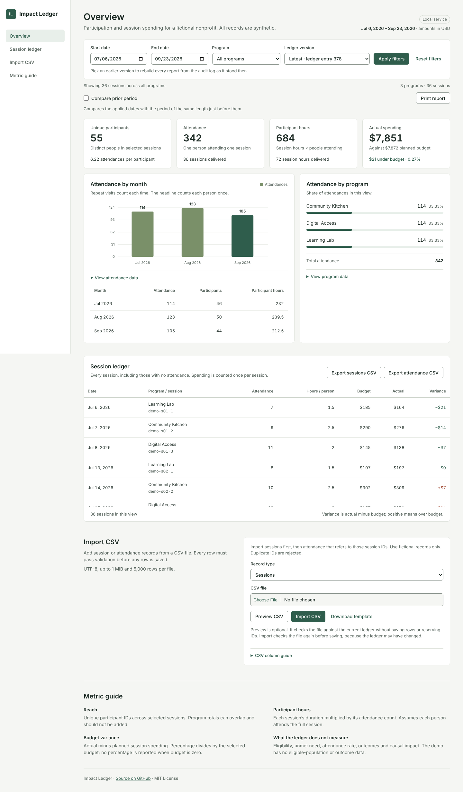

# Impact Ledger

[](https://github.com/ult666666/impact-ledger/actions/workflows/ci.yml)

A dashboard for a fictional nonprofit's participation and session spending. A Python
standard-library HTTP API and a SQLite ledger serve a TypeScript interface with no browser
runtime dependencies. Every record is synthetic.

[Static preview](https://ult666666.github.io/impact-ledger/) · [中文指南](docs/README.zh-CN.md) · [Guide](docs/GUIDE.md) · [Architecture](docs/ARCHITECTURE.md) · [API](docs/API.md) · [Data dictionary](docs/DATA_DICTIONARY.md) · [Release notes](CHANGELOG.md)



## Try it

Requires Python 3.11 or newer. The compiled frontend is committed, so Node is only needed to
change it.

```sh
python3 -m impact_ledger --db .local/demo.db seed
python3 -m impact_ledger --db .local/demo.db serve
```

Open http://127.0.0.1:8765. Add `--port 8766` to `serve` for another port; the server only
binds to loopback. `seed` refuses a ledger that already has data, so pick a new database path to
start over.

The seeded demo runs from July to September 2026, with 36 sessions and 342 attendances.
Spending is $7,851 against a $7,872 budget. The [guide](docs/GUIDE.md#demo-data) lists all the
demo totals.

To install the command instead:

```sh
python3 -m venv .local/venv
.local/venv/bin/pip install .
.local/venv/bin/impact-ledger --db .local/installed-demo.db seed
.local/venv/bin/impact-ledger --db .local/installed-demo.db serve
```

## What it does

- Filters by date range and program, applied to every metric, chart, table, export and printed
  report.
- Counts each person once across the selected sessions, each attendance once per person and
  session, and spending once per session. Budget variance is actual minus budget.
- Compares a date range with the period of the same length just before it, for the same
  program ([example](docs/screenshots/comparison.png)).
- Prints a report of the current view, which the browser can save as a PDF
  ([example](docs/screenshots/print-report.png)).
- Imports session and attendance CSV files atomically: a file with one bad row adds nothing. An
  optional preview lists the errors first ([example](docs/screenshots/import-preview.png)).
- Records every change in a hash-chained audit log, rebuilds any report as it stood after an
  earlier change, and undoes an import with a compensating batch.
- Exports sessions and attendance as CSV for the applied filters.

The [guide](docs/GUIDE.md) describes each feature, the CSV rules and the command-line
workflows.

## Command line

The same ledger works without the browser:

```sh
python3 -m impact_ledger --db .local/example.db init
python3 -m impact_ledger --db .local/example.db preview-import sessions examples/sessions.csv
python3 -m impact_ledger --db .local/example.db import sessions examples/sessions.csv
python3 -m impact_ledger --db .local/example.db import attendance examples/attendance.csv
python3 -m impact_ledger --db .local/example.db summary --program '社区服务'
python3 -m impact_ledger --db .local/demo.db comparison --start 2026-09-01 --end 2026-09-30 --program 'Learning Lab'
python3 -m impact_ledger --db .local/example.db export sessions --start 2026-10-01 --end 2026-10-31 --output .local/sessions.csv
```

Import sessions before attendance. The CSV headers must be these, in this order:

```csv
session_id,program,session_date,duration_hours,budget,actual
```

```csv
attendance_id,session_id,participant_id
```

Audit history has its own commands:

```sh
python3 -m impact_ledger --db .local/demo.db import sessions examples/sessions.csv
python3 -m impact_ledger --db .local/demo.db --actor analyst update-session demo-s01-1 --actual 190.50
python3 -m impact_ledger --db .local/demo.db delete-attendance demo-s01-1-a01
python3 -m impact_ledger --db .local/demo.db history --limit 5
python3 -m impact_ledger --db .local/demo.db summary --as-of-entry 378
python3 -m impact_ledger --db .local/demo.db undo-import B000379
python3 -m impact_ledger --db .local/demo.db verify --expect-head <hash saved from an earlier verify>
```

Entry 378 is the demo as seeded, before the import and the two corrections above. `verify`
checks the hash chain, its triggers and every replayed change against the current tables. Save
the head digest it prints somewhere else: with `--expect-head`, it also detects a log that was
cut short or rewritten. The [guide](docs/GUIDE.md#audit-history-past-reports-and-undo) explains
`--as-of`, exit codes and upgrades from 1.2.x.

## Build and test

Requires Node 24 or newer. TypeScript and Playwright are pinned in `package-lock.json`; Python
uses no third-party packages at run time.

```sh
npm ci --ignore-scripts
python3 -m unittest discover -s tests -v
npm run typecheck
npm run build
npm test
npx playwright install chromium
npm run test:browser
python3 scripts/build_site.py --verify-only
```

On Linux, `npx playwright install --with-deps chromium` also installs the browser's system
libraries. The browser tests run the local service and the static preview and save screenshots
under the ignored `test-results/screenshots/`; `IMPACT_LEDGER_UPDATE_SCREENSHOTS=1` refreshes
the images in `docs/screenshots/`.

`npm run build` also writes `site/`, a read-only static preview with a fixed synthetic
snapshot, where filters and CSV export work but import does not. Serve it with
`python3 -m http.server 8000 --bind 127.0.0.1 --directory site`. The
[guide](docs/GUIDE.md#static-preview) covers the payload, its verification and the CI
deployment.

## Limits

- It is not a case-management or accounting system: there is no authentication, backup,
  eligibility population or outcome data.
- Participation and spending describe activity; they do not show outcomes or causal impact.
- The audit log is tamper-evident, not tamper-proof, and actor labels are self-declared.
- Past reports replay the log, so they slow down as history grows. With 25,000 log entries, a
  summary as of the latest entry took 315 ms; from the current tables it took 68 ms
  (`python3 scripts/benchmark_history.py`).
- Do not import real participant records.

[Architecture](docs/ARCHITECTURE.md) and the [security policy](SECURITY.md) cover these in
detail.

Built with AI coding assistants. I reviewed the code and the tests that check it, but no
independent audit has been done; [VERIFICATION.md](docs/VERIFICATION.md) records what the checks
cover.

MIT licensed. Contributions: [CONTRIBUTING.md](CONTRIBUTING.md).
