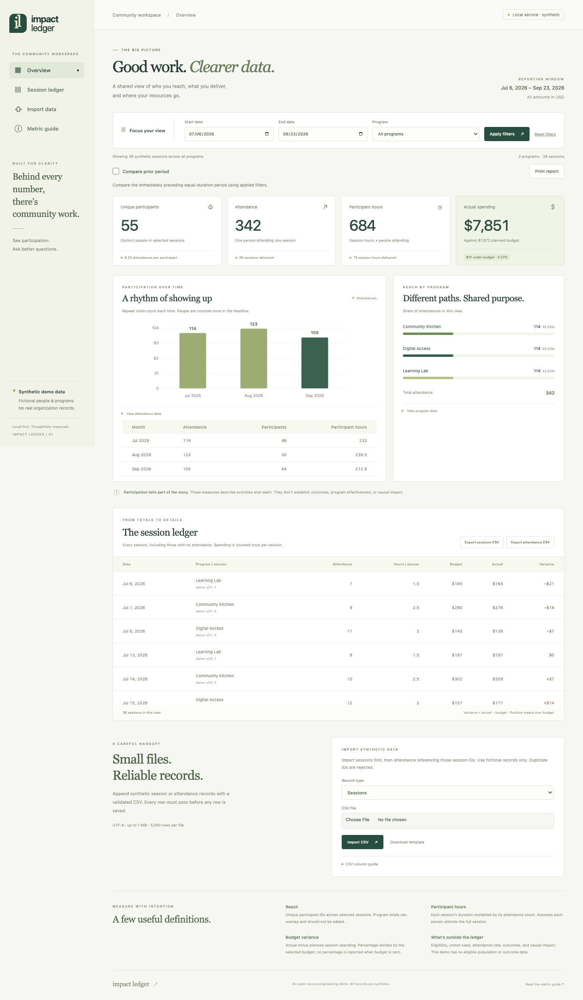

# Impact Ledger

[](https://github.com/ult666666/impact-ledger/actions/workflows/ci.yml)

A local-first operations dashboard for understanding nonprofit participation and session spending. A Python standard-library HTTP API and SQLite ledger power a compiled TypeScript interface with **zero browser runtime dependencies**.

**All records are synthetic.** This is an educational engineering project, with no real organization, participant information, or production-use claim. Participation and spending describe activity; they do not establish outcomes or causal impact.

[Read-only synthetic preview](https://ult666666.github.io/impact-ledger/) · [中文指南](docs/README.zh-CN.md) · [Architecture](docs/ARCHITECTURE.md) · [Data dictionary](docs/DATA_DICTIONARY.md) · [Verification](docs/VERIFICATION.md)



## Run locally

Requires Python **3.11+**. The committed frontend is already compiled; Node is needed only to edit/rebuild it.

```sh
python3 -m impact_ledger --db .local/demo.db seed
python3 -m impact_ledger --db .local/demo.db serve
```

Open **http://127.0.0.1:8765**. To use another local port, add `--port 8766` to `serve`. Stop with Ctrl-C. Seed refuses an existing nonempty ledger; choose a fresh database path to repeat the demo. The server always binds to loopback.

The deterministic July–September 2026 demo contains **36 sessions, 342 attendances, 55 participants, 684 participant hours, $7,872 planned spending, and $7,851 actual spending**. The $21 negative variance means spending is under budget. These are fixture totals, not organizational results.

Optional installed CLI:

```sh
python3 -m venv .local/venv
.local/venv/bin/pip install .
.local/venv/bin/impact-ledger --db .local/installed-demo.db seed
.local/venv/bin/impact-ledger --db .local/installed-demo.db serve
```

## What you can inspect

- Apply inclusive date and program filters to every metric, chart, table, and export.
- Count people distinctly across selected sessions, attendance once per person/session, and spending once per session.
- Opt in to **Compare prior period** for an explicit applied start/end date range. The previous window has the same number of calendar days and uses the same program. Both windows show totals and signed deltas; people can recur in both.
- Choose **Print report** for a synthetic stakeholder report with applied filters, all current totals, charts, tables, and comparison when enabled. Browser print settings can save a PDF.
- Compare actual and budget in USD. Percent variance uses budget as denominator and is undefined at zero budget.
- Open the exact accessible tables under both charts; use a keyboard to navigate the session table on small screens.
- Import UTF-8 CSV atomically. Files with bad headers, invalid dates/amounts, duplicate IDs, missing session references, or excess size/rows add **nothing**.
- Export both session and attendance CSVs for the **applied** filters. Edits in the form take effect when you choose Apply filters.
- Try an empty date range: the interface reports zero activity rather than substituting demo totals.

Comparison requires both explicit dates. Set them and choose Apply filters if a visible message requests them. A 2026-09-01 through 2026-09-30 current window compares with 2026-08-02 through 2026-08-31, not the previous calendar month. Empty windows show zeros. Signed changes describe activity; lower variance alone does not establish improvement. [Comparison and print example](docs/screenshots/print-report.png).

## CSV and CLI handoff

Import sessions before attendance. A session can have zero attendance; its spending is still included. Each file is append-only. Existing IDs and duplicate participant/session pairs are rejected.

```sh
python3 -m impact_ledger --db .local/example.db import sessions examples/sessions.csv
python3 -m impact_ledger --db .local/example.db import attendance examples/attendance.csv
python3 -m impact_ledger --db .local/example.db summary --program '社区服务'
python3 -m impact_ledger --db .local/demo.db comparison --start 2026-09-01 --end 2026-09-30 --program 'Learning Lab'
python3 -m impact_ledger --db .local/example.db export sessions --start 2026-10-01 --end 2026-10-31 --output .local/sessions.csv
```

CSV headers must match exactly and in this order:

```csv
session_id,program,session_date,duration_hours,budget,actual
```

```csv
attendance_id,session_id,participant_id
```

Dates use `YYYY-MM-DD`. Hours and USD amounts accept at most two decimal places; exponent notation, negatives, NaN, and infinity are rejected. One import is limited to **1 MiB and 5,000 data rows**. See the [data dictionary](docs/DATA_DICTIONARY.md) for bounds and definitions.

## Rebuild and test

Requires Node **24+**. TypeScript and Playwright are pinned in `package-lock.json`; Python has no third-party runtime packages.

```sh
npm ci --ignore-scripts
python3 -m unittest discover -s tests -v
npm run typecheck
npm run build
npm test
npx playwright install chromium
npm run test:browser
```

On Linux, use `npx playwright install --with-deps chromium` to install browser system libraries. Tests use temporary local databases and launch real loopback HTTP services. Browser checks exercise both local and static modes and save desktop/mobile screenshots under `docs/screenshots/`.

## Static preview

`npm run build` also creates `site/`: the same interface, a deterministic synthetic snapshot, functional filters, and client-side CSV export. Imports are disabled with an explanation because a static host cannot run SQLite. Preview it with:

```sh
python3 -m http.server 8000 --bind 127.0.0.1 --directory site
```

Open **http://127.0.0.1:8000**. Relative asset URLs work under a GitHub Pages repository path. The [Static preview workflow](.github/workflows/pages.yml) uploads this generated directory. Repository Pages must be configured to use GitHub Actions before deployment succeeds. It never deploys the Python write API.

## Scope and tradeoffs

Built to make data-to-stakeholder handoffs inspectable: strict inputs, explicit denominators, recoverable errors, and bilingual examples. There are no external integrations, provider calls, credentials, analytics beacons, or paid services. The interface loads no third-party assets.

This is **not a production case-management or accounting system**. No authentication, audit history, real eligibility population, outcomes, capacity, partial-attendance tracking, backup management, or causal identification is implemented. Session costs are direct session amounts, not organization-wide expenditures. Do not import private or real participant records. See [limitations and architecture](docs/ARCHITECTURE.md) and [security policy](SECURITY.md).

The implementation was developed with AI assistance. Automated checks and a rendered browser review cover the scope recorded in [VERIFICATION.md](docs/VERIFICATION.md); they do not replace independent human review or establish real-world impact.

MIT licensed. Contributions: [CONTRIBUTING.md](CONTRIBUTING.md).
