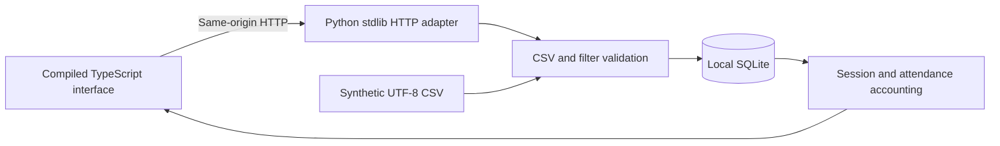

# Architecture and tradeoffs

Impact Ledger is a synthetic operations demo: a small full-stack system with explicit boundaries rather than a hosted participant database.

## Local request path

`impact_ledger/store.py` owns schema creation, input validation, transactions, filtering, aggregation, deterministic seeding, and CSV export. `server.py` translates bounded HTTP requests into store calls. `__main__.py` exposes the same behavior through the CLI. Each operation opens and closes its own SQLite connection, with foreign keys enabled. Summary reads use one SQLite read transaction so session and attendance queries share a snapshot.

Sessions and attendance are separate tables. Joining attendance directly to session costs and summing would multiply spending by attendance; the implementation instead selects sessions once, attaches their participant IDs, and sums session costs once. Unique participants are deduplicated inside the selected set. Sessions without attendance remain present.

Money is stored as integer cents, and duration as integer hundredths of an hour. Input decimals must already have at most two places; import never silently rounds them. Sums use integers; financial JSON values convert to USD at the output boundary. Ratio display uses two decimal places and half-up rounding: Decimal arithmetic in Python and integer-rational BigInt quotient/remainder arithmetic in the static model, with no floating pre-division. No fraction is reported for a zero denominator.

## Import transaction

1. Enforce the UTF-8, 1 MiB, exact-header, and 5,000-row limits.
2. Validate every row: ID syntax, date, label, decimal syntax and bounds.
3. Insert all rows in a single SQLite transaction. Primary keys, person/session uniqueness, and foreign keys enforce cross-row/database integrity.
4. Commit only if all inserts succeed. Otherwise roll back the complete file.

Imports append. They do not update or delete existing records. Sessions must be imported before referencing attendance. There is no partial-success mode. The CLI and HTTP API both call this path. Exports reuse the same inclusive session filters as summaries and produce the original import schema.

## Browser architecture

`web/src/app.ts` uses typed API responses, native HTML forms, DOM text nodes, SVG charts, and accessible HTML tables. There is no React, UI library, CDN script, remote font, or browser runtime package. TypeScript 5.9.3 compiles into the Python package's `static/` directory. Compiled JavaScript is committed so a wheel or source install can serve the dashboard without Node.

Applied filters are held separately from edits in the form. Downloads correspond to the applied view. A request revision prevents a slower prior filter response from replacing a newer view. Import errors are presented without clearing the file or claiming rows were saved. An imported file refreshes metadata; existing date filters still apply until reset.

Charts are accompanied by exact-value tables. Empty selections display zero activity and undefined ratios. The mobile session table has its own scroll container so the document itself does not overflow. Labels are rendered with `textContent`/text nodes; CSV text is never assigned to `innerHTML`.

## Read-only static mode

`scripts/build_site.py` copies the same compiled browser assets into `site/`, changes a `data-mode` attribute, and generates a deterministic `demo.json` snapshot from an empty seeded SQLite database. In this mode, `model.ts` performs the same integer accounting in the browser. Unit fixtures check hand-derived metrics, dates, CSV quoting, and IDs for both calculation paths. Browser tests check real interactions in both modes.

Static preview filters and exports run locally in the viewer's browser. Imports are visibly disabled; no API or SQLite writes are hosted. Assets use relative paths so the bundle can be mounted under `/impact-ledger/`. `site/` is ignored reproducible output. The Pages workflow builds it anew; it requires the repository owner to enable GitHub Actions as the Pages source.

## HTTP contract

All successful JSON responses include `synthetic: true` where applicable; currency is USD. All application-level errors use `{ "error": "readable message" }`. The standard library may generate its own responses for invalid HTTP framing before the handler runs. Unknown/repeated query keys are rejected. Request targets must use origin form; malformed/absolute targets and fragments are rejected with JSON 400.

| Method | Route | Behavior |
| --- | --- | --- |
| GET | `/api/health` | Local health, no database path |
| GET | `/api/meta` | All-program list, date bounds, session/attendance counts, import limits |
| GET | `/api/summary?start=&end=&program=` | Totals, per-program and monthly aggregates, session ledger |
| GET | `/api/snapshot?start=&end=&program=` | Synthetic session rows, integer units, participant/attendance IDs |
| GET | `/api/export?kind=sessions\|attendance&start=&end=&program=` | Filtered attachment in import CSV schema |
| POST | `/api/import?kind=sessions\|attendance` | Append UTF-8 `text/csv`; successful response is 201 with kind/imported count |
| GET | `/`, `/app.js`, `/model.js`, `/styles.css`, `/favicon.svg` | Explicit static asset allowlist |

Optional dates are inclusive. Omitted/blank filters are unbounded. Program matching is exact and case-sensitive. `kind` is required for import/export. No pagination is implemented; summaries/snapshots return every selected session, so large databases are outside the intended scope.

Application error statuses: 400 for validation/framing errors, 403 for invalid Host/cross-origin writes, 404 for unknown routes, 405 for unsupported methods on known API routes, 408 for an incomplete timed-out body, 411 for missing length, 413 for oversized length, 415 for unsupported CSV encoding/media type, and 503 for unavailable SQLite or missing built assets. Failed imports add no rows.

## Local security and deployment limits

The server binds to `127.0.0.1` and checks exact `localhost:port`/`127.0.0.1:port` Host values. It rejects duplicate Hosts, cross-site import requests, unsupported transfer encoding, invalid/oversized lengths, malformed UTF-8, and other CSV failures. Request reads time out after five seconds. Responses use a restrictive CSP, `nosniff`, `no-store`, and no CORS headers. SQL values are parameterized. See [SECURITY.md](../SECURITY.md).

These controls do not make a production service. Thread count, database growth, and request rate are not bounded; there is no authentication or TLS. Do not expose the Python service on a public host or through a reverse proxy. The static preview is the intended public deployment.

## Measurement limits

- Participant IDs are fictional pseudonyms, not identity resolution. Reusing or changing an ID changes reach totals.
- Full-session attendance is assumed. Participant hours do not measure attention, quality, or benefit.
- There is no invited/eligible/capacity denominator, so an attendance **rate** cannot be computed.
- Costs are direct amounts assigned to selected sessions. There is no chart of accounts, restricted-fund accounting, overhead allocation, currency conversion, or audit history.
- A person can appear in multiple programs/months; distinct-person subtotals are not additive.
- Monthly charts include months that have selected sessions, rather than filling missing calendar months with inferred activity.
- Spending differences do not explain causes or signal program effectiveness. There are no outcome data or counterfactuals.
- The app always labels data synthetic. That label is a usage contract, not a way to detect real records; use fictional inputs only.
- Decimal totals are exact in stored integer units. Browser/JSON numbers are suitable for this small demo, not arbitrary-precision financial exchange. The static model requires summed integer cents/hundredths and ratio numerators/denominators to remain within JavaScript’s safe integer range (absolute value ≤ 9,007,199,254,740,991). It also checks the rounded ratio in hundredths before converting it to a number; unsupported totals raise a visible error instead of silently rounding the intermediate arithmetic.

The initial release was AI-assisted and checked through the tests and visual review listed in [VERIFICATION.md](VERIFICATION.md). It is not independently audited or evidence of adoption.
