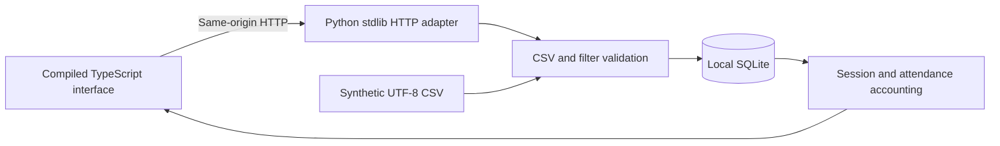

# Architecture and tradeoffs

Impact Ledger is a synthetic operations demo: a small full-stack system with explicit boundaries rather than a hosted participant database.

## Local request path



`impact_ledger/store.py` owns schema creation, transactions, filtering, aggregation, deterministic seeding, and CSV export. `csv_import.py` owns the shared CSV parser, field rules and read-only duplicate/reference checks used by both preview and import. `server.py` translates bounded HTTP requests into store calls. `__main__.py` exposes the same behavior through the CLI. Each operation opens and closes its own SQLite connection, with foreign keys enabled. Summary and comparison reads use one SQLite read transaction so session and attendance queries share a snapshot.

Sessions and attendance are separate tables. Joining attendance directly to session costs and summing would multiply spending by attendance; the implementation instead selects sessions once, attaches their participant IDs, and sums session costs once. Unique participants are deduplicated inside the selected set. Sessions without attendance remain present.

Money is stored as integer cents, and duration as integer hundredths of an hour. Input decimals must already have at most two places; import never silently rounds them. Sums use integers; financial JSON values convert to USD at the output boundary. Ratio display uses two decimal places and half-up rounding: Decimal arithmetic in Python and integer-rational BigInt quotient/remainder arithmetic in the static model, with no floating pre-division. No fraction is reported for a zero denominator.

## Import transaction

1. Acquire `BEGIN IMMEDIATE`, then use the shared validator to enforce UTF-8, 1 MiB, exact headers, 5,000 rows, ID/date/label rules and exact decimals.
2. Check duplicates inside the file and current ledger, participant/session pairs and session references with SELECTs in that same transaction.
3. If any diagnostic exists, raise a readable `ValidationError` before insertion. Otherwise insert all rows. Primary keys, pair uniqueness and foreign keys remain the final constraint guard.
4. Commit only if all inserts succeed. Otherwise roll back the complete file.

`Store.preview_csv` calls the identical validator in a separate SQLite `mode=ro` connection with explicit `BEGIN`, so ID/reference queries share one snapshot and cannot execute ledger/schema SQL writes. There are no trial inserts, trigger execution, schema initialization or reservations. `Store.open_existing` bypasses the schema-creating constructor; CLI preview uses it to require an initialized database without creating missing paths. SQLite may create or update locking/WAL auxiliary files (`-wal`/`-shm`) for an existing database, including when opening a closed WAL ledger in `mode=ro`; the SQL read-only promise is not directory-entry immutability. The application does not delete SQLite sidecars or use immutable-mode reads. A closed-WAL regression proves accepted library/CLI preview preserves main-file bytes/mtime and logical rows/schema, while permitting these SQLite auxiliaries. A separate real WAL concurrency test observes a commit between validation queries and proves preview retains the original snapshot. Real import always reparses and revalidates current bytes/state; it does not consume preview results or tokens. A stale valid preview therefore cannot authorize a conflicting import.

Preview processes bounded input, displays at most 100 diagnostics and counts all errors found within at most 5,000 checked records. A terminal parsing/size/row-limit error is file-level and remains visible even if the error table is full. `rows` counts checked CSV records, while each row diagnostic identifies the physical starting line of that record, accounting for quoted newlines. All messages describe rules without echoing file values. See the [API response and codes](API.md).

Imports append. They do not update or delete existing records. Sessions must be imported before referencing attendance. There is no partial-success mode. The CLI and HTTP API both call this path. Exports reuse the same inclusive session filters as summaries and produce the original import schema.

## Browser architecture

`web/src/app.ts` uses typed API responses, native HTML forms, DOM text nodes, SVG charts, and accessible HTML tables. There is no React, UI library, CDN script, remote font, or browser runtime package. TypeScript 5.9.3 compiles into the Python package's `static/` directory. Compiled JavaScript is committed so a wheel or source install can serve the dashboard without Node.

The browser holds draft form inputs, the latest submitted filter intent, and the last completed applied view separately. Downloads, comparisons, and print reports correspond to the applied view. Comparison has its own request revision, clears during filter refresh or a failed update, and explains missing dates. Successful imports reload the latest submitted filters, including an Apply request still in flight; their automatic refresh cannot replace a newer submitted intent with the older completed view. Draft edits remain unapplied. A request revision prevents a slower prior filter response from replacing a newer view. Import errors are presented without clearing the file or claiming rows were saved. An imported file refreshes metadata; existing date filters still apply until reset. Optional CSV previews have a separate request revision: file/kind changes clear diagnostics and invalidate delayed responses. Import clears preview and submits the file again through the normal atomic import endpoint. Preview never changes filter, summary, comparison or print state.

Charts are accompanied by exact-value tables. Empty selections display zero activity and undefined ratios. The mobile session table has its own scroll container so the document itself does not overflow. Labels are rendered with `textContent`/text nodes; CSV text is never assigned to `innerHTML`.

## Read-only static mode

`scripts/build_site.py [--output-directory PATH] [--verify-only]` builds or verifies exactly seven regular files. Four assets (app.js, model.js, styles.css, favicon.svg) match committed source bytes. index.html changes only the existing `data-mode="local"` attribute to `data-mode="static"`; demo.json retains compact UTF-8 plus LF from the deterministic empty seeded SQLite snapshot; .nojekyll is empty. The default output remains repository `site/`. In static mode, `model.ts` performs the same integer accounting in the browser. Unit fixtures check hand-derived metrics, dates, CSV quoting, and IDs for both calculation paths. Browser tests check real interactions in both modes.

Before target writes, preflight rejects a selected directory symlink, source/output overlap, unknown files/folders and symlink/nonregular generated entries. The parent must resolve strictly through existing directories before the final selected entry is checked with lstat; missing components cannot be erased by `missing/..`. Trusted existing ancestor aliases are canonicalized. A missing final output directory can be created if its parent exists; known outputs can be rebuilt with missing/modified regular generated files. No unknown entry is deleted or implicitly approved. Expected bytes are fully prepared before staging private temporary files in the output directory. Each allowed filename is atomically replaced, avoiding writes through existing hard links. Ordinary errors remove owned temporary files; a failed replacement can leave mixed generated versions. The entire directory is not an atomic publication and concurrent path manipulation/power-loss recovery are outside scope.

Verification-only does not create/repair/write target entries. It inventories actual output and compares every byte, including compiled assets, valid-looking but altered synthetic JSON and nonempty .nojekyll. Expected seed generation writes a separate private temporary database; target reads may update access times. A bounded JSON receipt reports operation/validity, seven known-file byte counts/SHA-256 digests on success, or a stable failure code and optional known filename. Unknown names/contents and exception paths are not printed. Exit 0 means exact; 1 is controlled boundary/content/I/O failure; 2 is argparse usage error.

Static preview filters and exports run locally in the viewer's browser. Both CSV preview and import are visibly disabled with a local-API explanation; no database validation is simulated and no API or SQLite writes are hosted. Assets use relative paths so the bundle can be mounted under `/impact-ledger/`. `site/` is ignored reproducible output. Repository Pages must already use GitHub Actions as the source.

One `ci.yml` workflow runs the Python 3.11/3.13 full/installed matrix in parallel with Node24 typecheck → build → 13 model tests → real Chromium checks → exact verification of that same `site/` → main/non-PR artifact upload. Deploy needs both successful jobs, consumes its own workflow artifact, and retains the github-pages environment URL. Only that guarded job grants pages/id-token write permissions; all other jobs inherit contents read. PR and non-main manual events run all tests and skip publication. Ref-scoped concurrency prevents a non-main manual run cancelling main. Jobs have finite 15-minute timeouts, pinned actions and checkout credentials disabled; screenshot artifacts expire in seven days. Explicit Ubuntu24.04 avoids automatic `ubuntu-latest` image migration; see the [official runner catalog](https://github.com/actions/runner-images). There is no cross-run workflow_run/download privilege bridge.

## HTTP contract

All successful JSON responses include `synthetic: true` where applicable; currency is USD. All application-level errors use `{ "error": "readable message" }`. The standard library may generate its own responses for invalid HTTP framing before the handler runs. Unknown/repeated query keys are rejected. Request targets must use origin form; malformed/absolute targets and fragments are rejected with JSON 400.

| Method | Route | Behavior |
| --- | --- | --- |
| GET | `/api/health` | Local health, no database path |
| GET | `/api/meta` | All-program list, date bounds, session/attendance counts, import limits |
| GET | `/api/summary?start=&end=&program=` | Totals, per-program and monthly aggregates, session ledger |
| GET | `/api/comparison?start=YYYY-MM-DD&end=YYYY-MM-DD&program=` | Explicit inclusive dates required; current and immediately preceding equal-day totals and signed deltas |
| GET | `/api/snapshot?start=&end=&program=` | Synthetic session rows, integer units, participant/attendance IDs |
| GET | `/api/export?kind=sessions\|attendance&start=&end=&program=` | Filtered attachment in import CSV schema |
| POST | `/api/import?kind=sessions\|attendance` | Append UTF-8 `text/csv`; successful response is 201 with kind/imported count |
| POST | `/api/import/preview?kind=sessions\|attendance` | Read-only advisory diagnostics; valid and invalid CSV return 200, with bounded errors |
| GET | `/`, `/app.js`, `/model.js`, `/styles.css`, `/favicon.svg` | Explicit static asset allowlist |

Summary/snapshot/export dates are optional and inclusive. Omitted/blank filters are unbounded. Program matching is exact and case-sensitive. `kind` is required for import/export. No pagination is implemented; summaries/snapshots return every selected session, so large databases are outside the intended scope.

Application error statuses: 400 for validation/framing errors, 403 for invalid Host/cross-origin writes, 404 for unknown routes, 405 for unsupported methods on known API routes, 408 for an incomplete timed-out body, 411 for missing length, 413 for oversized length, 415 for unsupported CSV encoding/media type, and 503 for unavailable SQLite or missing built assets. Failed imports add no rows. Preview content diagnostics use 200 with `valid: false`; invalid kind or HTTP framing still uses the existing 4xx contract. See [API.md](API.md).

## Comparison and print contract

`Store.comparison(start, end, program)`, CLI `comparison --start ... --end ... [--program ...]`, GET `/api/comparison`, and TypeScript `comparisonFromSnapshot(snapshot, filters)` share this small response:

```json
{
  "synthetic": true, "currency": "USD",
  "filters": {"start": "2026-09-01", "end": "2026-09-30", "program": "Learning Lab"},
  "days": 30,
  "current": {"start": "2026-09-01", "end": "2026-09-30", "totals": {}},
  "previous": {"start": "2026-08-02", "end": "2026-08-31", "totals": {}},
  "deltas": {}
}
```

Each `totals` object has all ten standard summary measures. `deltas` contains only `sessions`, `unique_participants`, `attendance`, `participant_hours`, `session_hours`, `budget`, `actual`, and `variance`, with current minus previous. Money/hour deltas subtract integer cents/hundredths before converting for JSON. Existing ratios retain half-up rounding and zero-denominator nulls; no percentage-change fields are calculated.

Both dates must exist in years 0001–9999 and start must be on or before end. For inclusive `[start,end]`, `days = end − start + 1`; previous is `[start − days,start − 1]`. Python uses calendar dates and TypeScript uses ISO UTC day numbers, with no local wall-time/DST arithmetic. Previous-range underflow before 0001-01-01, absent/blank dates, malformed dates, and inverted dates produce controlled errors. Unbounded summary remains separately available. Program matching is identical in both windows, including Unicode labels. Shared hand-derived JSON oracles in `tests/fixtures/comparison.json` are consumed by Python and Node.

Print CSS adds a stakeholder title, synthetic notice, explicit applied filters (including unbounded labels), and all eight current totals. It includes comparison only while enabled and available. Print lifecycle handlers open exact-value chart tables and restore disclosure state afterwards. Navigation, forms, and buttons disappear; scroll limits and table minimum widths are removed so full tables paginate. The Print report button starts disabled and has a guarded click handler. A visible readiness message blocks printing while the initial/current summary, an import refresh, or an enabled comparison is pending. A summary failure keeps printing blocked until a successful refresh. A completed comparison failure allows the current summary report, with an explicit “Comparison unavailable” reason included in print. Comparison toggles during a summary refresh wait for that submitted view rather than requesting the old applied one. The report does not claim a generated data date or external provenance. Print pagination and browser PDF output are checked in Chromium; physical printer behavior varies by browser/printer.

## Local security and deployment limits

The server binds to `127.0.0.1` and checks exact `localhost:port`/`127.0.0.1:port` Host values. Both CSV routes reject duplicate Hosts, cross-site requests, unsupported transfer encoding, invalid/oversized lengths and unsupported media types/charsets. CSV validation errors, including malformed UTF-8, return bounded diagnostics in preview and prevent writes in import. Request reads time out after five seconds. Responses use a restrictive CSP, `nosniff`, `no-store`, and no CORS headers. SQL values are parameterized. See [SECURITY.md](../SECURITY.md).

These controls do not make a production service. Thread count, database growth, and request rate are not bounded; there is no authentication or TLS. Do not expose the Python service on a public host or through a reverse proxy. The static preview is the intended public deployment.

## Measurement limits

- Participant IDs are fictional pseudonyms, not identity resolution. Reusing or changing an ID changes reach totals.
- Full-session attendance is assumed. Participant hours do not measure attention, quality, or benefit.
- There is no invited/eligible/capacity denominator, so an attendance **rate** cannot be computed.
- Costs are direct amounts assigned to selected sessions. There is no chart of accounts, restricted-fund accounting, overhead allocation, currency conversion, or audit history.
- A person can appear in multiple programs/months; distinct-person subtotals are not additive.
- Monthly charts include months that have selected sessions, rather than filling missing calendar months with inferred activity.
- Spending differences do not explain causes or signal program effectiveness. There are no outcome data or counterfactuals.
- The app always labels data synthetic. That label is a usage contract, not a way to detect real records; use fictional inputs only.
- Decimal totals are exact in stored integer units. Browser/JSON numbers are suitable for this small demo, not arbitrary-precision financial exchange. The static model requires summed integer cents/hundredths and ratio numerators/denominators to remain within JavaScript’s safe integer range (absolute value ≤ 9,007,199,254,740,991). It also checks the rounded ratio in hundredths before converting it to a number; unsupported totals raise a visible error instead of silently rounding the intermediate arithmetic.

The initial release was AI-assisted and checked through the tests and visual review listed in [VERIFICATION.md](VERIFICATION.md). It is not independently audited or evidence of adoption.
